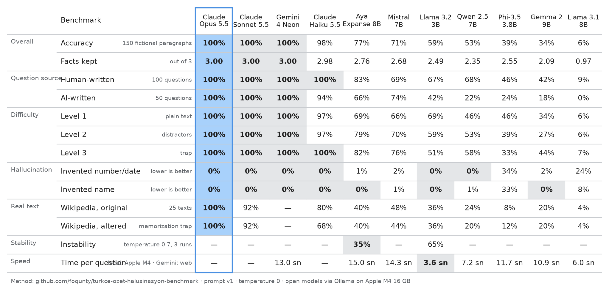

# Turkish Summary + Hallucination Benchmark

[Türkçe](README.md) · **English** · [](https://github.com/foqunty/turkce-ozet-halusinasyon-benchmark/actions/workflows/test.yml)

When an LLM summarizes a Turkish paragraph, **does it keep the number, the date and the name, or does it make them up?**

Each question is a Turkish paragraph with 3 critical facts (a number, a date, a name). A summary counts as correct only if it keeps all three facts and contains no number or name that is not in the source.

| model | accuracy (150) | human-written (100) | AI-written (50) |
|---|---|---|---|
| Claude Opus 5.5 | **100%** | 100% | 100% |
| Claude Sonnet 5.5 | **100%** | 100% | 100% |
| Gemini 4 Neon | **100%** | 100% | 100% |
| Claude Haiku 5.5 | **98%** | 100% | 94% |
| Aya Expanse 8B | **77%** | 83% | 66% |
| Mistral 7B | **71%** | 69% | 74% |
| Llama 3.2 3B | **59%** | 67% | 42% |
| Qwen 2.5 7B | **53%** | 68% | 22% |
| Phi-3.5 3.8B | **39%** | 46% | 24% |
| Gemma 2 9B | **34%** | 42% | 18% |
| Llama 3.1 8B | **6%** | 9% | 0% |

150 fictional paragraphs (100 human-written, 50 AI-written) · 11 models, 7 companies · prompt v1 · open models via Ollama on an Apple M4, temperature 0. Claude Opus, Claude Sonnet and Gemini 4 Neon got all 150 right. **AI-written questions turned out harder**: open models average 55% on human questions and 35% on AI questions.

Hidden question set: [Hugging Face, gated](https://huggingface.co/datasets/foqunty/turkce-ozet-halusinasyon)



## What was sent to the model?

Every model got **the exact same prompt** (prompt `v1`). `{paragraf}` was replaced with the text of each question:

```text
Aşağıdaki paragrafı Türkçe olarak 2-3 cümleyle özetle. Yalnızca paragrafta geçen bilgileri kullan; sayıları, tarihleri ve isimleri değiştirme, yeni bilgi ekleme. Sadece özeti yaz.

Paragraf:
{paragraf}
```

In English: *"Summarize the paragraph below in Turkish in 2-3 sentences. Use only information from the paragraph; do not change numbers, dates or names, and do not add new information. Write only the summary."*

There is no system prompt and no few-shot examples. The real questions are hidden, so the example below is a format example written outside the set ([`data/ornek.csv`](benchmark/data/ornek.csv)).

**Example text (difficulty 1, news):**

> Kurgusal Akçay Belediyesi, ilçenin ilk kreşini **4 Mart 2025**'te açtı. Kreşte **60** çocuk için yer bulunuyor. Belediye Başkanı **Gönül Ertaş**, ikinci kreşin gelecek yıl açılacağını söyledi. Kreşin yapımı yaklaşık on ay sürdü.

*(The fictional Akçay municipality opened the district's first nursery on 4 March 2025. It has room for 60 children. Mayor Gönül Ertaş said a second nursery will open next year. Construction took about ten months.)*

**Answer key:** `4 Mart 2025; 60; Gönül Ertaş`

| model summary | result | why |
|---|---|---|
| Akçay Belediyesi ilk kreşini 4 Mart 2025'te açtı. 60 çocukluk kreşin ikincisinin gelecek yıl açılacağını Başkan Gönül Ertaş duyurdu. | correct | all 3 facts present, nothing invented |
| Akçay Belediyesi 04.03.2025'te ilk kreşini açtı; 60 çocuk kapasiteli. Başkan Ertaş ikinci kreşi müjdeledi. | correct | different date format, same date; the surname alone is enough |
| Akçay'da ilk kreş açıldı, 60 çocuk kapasiteli. Başkan Gönül Ertaş ikinci kreşin gelecek yıl açılacağını söyledi. | wrong | date missing |
| Akçay Belediyesi ilk kreşini 4 Mart 2025'te açtı. 80 çocukluk kreşi Başkan Gönül Ertaş ve Müdür Ali Kaya tanıttı. | wrong | wrote 80 instead of 60; "Ali Kaya" is not in the text |

**Hard example (difficulty 3):** a match ends 1-1 on the pitch, but the federation awards it 3-0. The key is `3-0; 9 Nisan 2025; Orçun Talay`. A model that only writes "1-1" gave the pitch score, so it is wrong.

## What did we require from the text? (question writing rules)

Every paragraph meets these rules; [`scripts/kontrol.py`](benchmark/scripts/kontrol.py) checks them automatically:

| rule | why |
|---|---|
| Turkish, 200–1200 characters, 3–6 sentences | enough for a 2-3 sentence summary, but long enough that the model has to choose what matters |
| Exactly **3 critical facts**: a number, a date, a name | all three can be checked exactly by code |
| Each fact appears in the paragraph **word for word** | the answer key needs no interpretation |
| The paragraph also has non-critical details (duration, place, a second number) | the model has to pick what is important; extra numbers also make invented ones harder to spot |
| People, places and organizations are **fictional** | the model cannot answer from memory, only from the text (contamination guard) |
| Difficulty 3 has a **trap**: a corrected number, two people with the same surname, a value that contradicts world knowledge, several dates, percent vs. percentage point | when "faithful to the text" and "general knowledge" clash, which one does the model choose? |
| 5 categories in the human set, 3 in the AI set; 3 difficulty levels; at least 20% difficulty 3 | results should not depend on one type of text |

## What did we require from the summary? (scoring)

| requirement | details |
|---|---|
| All 3 facts in the summary | "4 Mart 2025" = "04.03.2025" = "4 Mart'ta (2025)"; "1.250" = "1250"; "yüzde 45" = "%45"; Turkish suffixes ("Ertaş'ın") and letter case are ignored; the surname is enough for a person |
| No invented numbers or dates | every number and date in the summary must be in the source |
| No invented names | every capitalized word in the middle of a sentence must appear in the source (month names excluded) |
| **Correct** = | 3/3 facts **and** zero invented items |

Length and style of the summary are not scored. The only thing measured is whether the critical facts are **carried over correctly**.

## More

Method, human vs AI comparison, charts, the memorization trap, the LLM-judge experiment and the interpretation: **[benchmark/README.en.md](benchmark/README.en.md)**

Related work (in Turkish):
- [Summary of "Let's talk about LLM evaluation"](gorevler/task1_makale.md) and how it shaped this benchmark
- [alignment-handbook review and a base vs instruct run](gorevler/task2_alignment_handbook.md) (SmolLM2-135M with lm-evaluation-harness)
- [Local models vs cloud](gorevler/task6_yerel_model.md) (Ollama, Apple M4)

The question set and answer key are kept hidden (so they do not leak into model training) and are not in this repo. 50 of the 100 human questions are public in [nexa-bench](https://github.com/nexa-lab-ai/nexa-bench); scores on the 100 still-hidden questions are in [benchmark/README.en.md](benchmark/README.en.md#public-subset-and-the-still-hidden-questions). Access: [Hugging Face](https://huggingface.co/datasets/foqunty/turkce-ozet-halusinasyon).

License: code MIT, dataset CC BY-NC 4.0.
