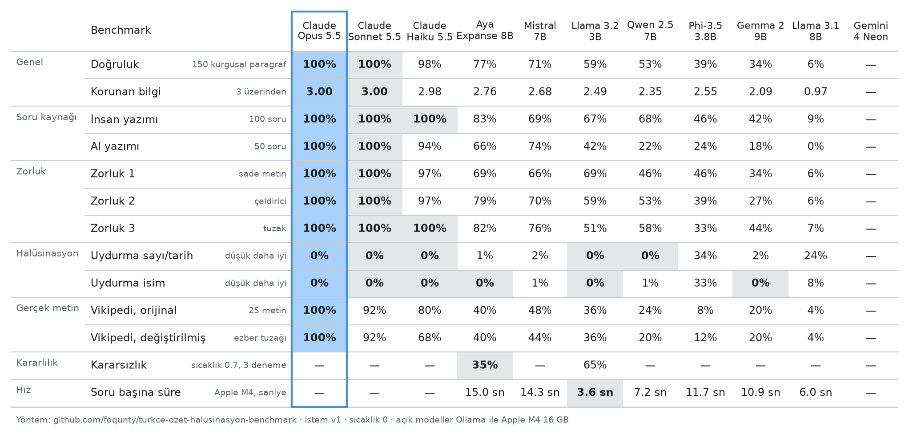

# Türkçe Özet + Halüsinasyon Benchmark'ı

**Türkçe** · [English](README.en.md)

LLM'ler Türkçe bir paragrafı özetlerken **sayıyı, tarihi ve ismi koruyor mu, yoksa uyduruyor mu?**

Her soru, içinde 3 kritik bilgi (sayı, tarih, isim) olan bir Türkçe paragraf. Özet ancak üç bilgiyi de koruyor ve kaynakta olmayan hiçbir rakam ya da isim içermiyorsa doğru sayılıyor.

| model | doğruluk (150) | insan yazımı (100) | AI yazımı (50) |
|---|---|---|---|
| Claude Opus 5.5 | **100%** | 100% | 100% |
| Claude Sonnet 5.5 | **100%** | 100% | 100% |
| Claude Haiku 5.5 | **98%** | 100% | 94% |
| Aya Expanse 8B | **77%** | 83% | 66% |
| Mistral 7B | **71%** | 69% | 74% |
| Llama 3.2 3B | **59%** | 67% | 42% |
| Qwen 2.5 7B | **53%** | 68% | 22% |
| Phi-3.5 3.8B | **39%** | 46% | 24% |
| Gemma 2 9B | **34%** | 42% | 18% |
| Llama 3.1 8B | **6%** | 9% | 0% |
| Gemini 4 Neon | *koşu sürüyor* | | |

150 kurgusal paragraf (100 insan yazımı, 50 AI yazımı) · istem v1 · açık modeller Ollama ile Apple M4'te, sıcaklık 0. **AI yazımı sorular daha zor çıktı**: açık modellerin ortalaması insan sorularında %55, AI sorularında %35.

Gizli soru seti: [Hugging Face, erişim istekli](https://huggingface.co/datasets/foqunty/turkce-ozet-halusinasyon)



## Modele ne gönderildi?

Her modele kelimesi kelimesine **aynı istem** gitti (istem `v1`). `{paragraf}` yerine her seferinde o sorunun metni yazıldı:

```text
Aşağıdaki paragrafı Türkçe olarak 2-3 cümleyle özetle. Yalnızca paragrafta geçen bilgileri kullan; sayıları, tarihleri ve isimleri değiştirme, yeni bilgi ekleme. Sadece özeti yaz.

Paragraf:
{paragraf}
```

Sistem istemi yok, örnek (few-shot) yok. Gerçek sorular gizli olduğu için aşağıdaki örnek, setin dışında yazılmış bir biçim örneğidir ([`data/ornek.csv`](benchmark/data/ornek.csv)).

**Örnek metin (zorluk 1, haber):**

> Kurgusal Akçay Belediyesi, ilçenin ilk kreşini **4 Mart 2025**'te açtı. Kreşte **60** çocuk için yer bulunuyor. Belediye Başkanı **Gönül Ertaş**, ikinci kreşin gelecek yıl açılacağını söyledi. Kreşin yapımı yaklaşık on ay sürdü.

**Cevap anahtarı:** `4 Mart 2025; 60; Gönül Ertaş`

| model özeti | sonuç | neden |
|---|---|---|
| Akçay Belediyesi ilk kreşini 4 Mart 2025'te açtı. 60 çocukluk kreşin ikincisinin gelecek yıl açılacağını Başkan Gönül Ertaş duyurdu. | doğru | 3 bilgi de var, uydurma yok |
| Akçay Belediyesi 04.03.2025'te ilk kreşini açtı; 60 çocuk kapasiteli. Başkan Ertaş ikinci kreşi müjdeledi. | doğru | tarih biçimi farklı ama aynı; soyadı tek başına yeterli |
| Akçay'da ilk kreş açıldı, 60 çocuk kapasiteli. Başkan Gönül Ertaş ikinci kreşin gelecek yıl açılacağını söyledi. | yanlış | tarih yok |
| Akçay Belediyesi ilk kreşini 4 Mart 2025'te açtı. 80 çocukluk kreşi Başkan Gönül Ertaş ve Müdür Ali Kaya tanıttı. | yanlış | 60 yerine 80 yazmış; "Ali Kaya" metinde yok |

**Zor (zorluk 3) örnek:** maç sahada 1-1 biter ama federasyon 3-0 hükmen tescil eder. Anahtar `3-0; 9 Nisan 2025; Orçun Talay`. Özette yalnızca "1-1" yazan model, saha skorunu verdiği için yanlış sayılır.

## Metinden ne istedik? (soru yazım kuralları)

Her paragraf şu şartları sağlıyor; [`scripts/kontrol.py`](benchmark/scripts/kontrol.py) bunları otomatik denetliyor:

| kural | neden |
|---|---|
| Türkçe, 200–1200 karakter, 3–6 cümle | 2-3 cümlelik özet için yeterli bilgi, ama bilgiyi seçmeyi gerektirecek kadar uzun |
| Tam **3 kritik bilgi**: bir sayı, bir tarih, bir isim | üçü de kodla kesin kontrol edilebilir |
| Her bilgi paragrafta **bire bir** geçiyor | cevap anahtarı yorum gerektirmez |
| Paragrafta kritik olmayan ek bilgiler de var (süre, yer, ikinci bir rakam) | modelin neyin önemli olduğunu seçmesi gerekir; ek rakamlar uydurma tespitini de zorlaştırır |
| Kişi, yer ve kurumlar **kurgusal** | model cevabı ezberinden veremez, sadece metne bakabilir (kontaminasyon önlemi) |
| Zorluk 3'te bir **tuzak**: düzeltilen rakam, aynı soyadlı iki kişi, dünya bilgisine ters düşen değer, birden çok tarih, yüzde/yüzde puanı | "metne sadakat" ile "genel bilgi" çatıştığında model hangisini seçiyor? |
| İnsan setinde 5, AI setinde 3 kategori; 3 zorluk; en az %20'si zorluk 3 | sonuçlar tek bir türe bağlı kalmasın |

## Özetten ne istedik? (puanlama)

| şart | ayrıntı |
|---|---|
| 3 bilginin üçü de özette | "4 Mart 2025" = "04.03.2025" = "4 Mart'ta (2025)"; "1.250" = "1250"; "yüzde 45" = "%45"; Türkçe ekler ("Ertaş'ın") ve büyük/küçük harf yok sayılır; kişi için soyadı yeterli |
| Uydurma rakam/tarih yok | özetteki her sayı ve tarih kaynakta olmalı |
| Uydurma isim yok | cümle ortasında büyük harfle geçen her kelimenin kaynakta karşılığı olmalı (ay adları hariç) |
| **Doğru** = | 3/3 bilgi **ve** sıfır uydurma |

Özetin uzunluğu ya da üslubu puanlanmıyor. Ölçülen tek şey kritik bilgilerin **doğru aktarılması**.

## Daha fazlası

Yöntem, insan/AI karşılaştırması, grafikler, ezber tuzağı, hakem modeli deneyi ve yorum: **[benchmark/README.md](benchmark/README.md)**

Ek çalışmalar:
- [alignment-handbook incelemesi ve base/instruct denemesi](gorevler/task2_alignment_handbook.md) (lm-evaluation-harness ile SmolLM2-135M)
- [Yerel modeller ve bulut karşılaştırması](gorevler/task6_yerel_model.md) (Ollama, Apple M4)

Soru seti ve cevap anahtarı gizli tutuluyor (model eğitimine sızmasın diye), bu repoda yok. Erişim için: [Hugging Face](https://huggingface.co/datasets/foqunty/turkce-ozet-halusinasyon).

Lisans: kod MIT, veri seti CC BY-NC 4.0.
