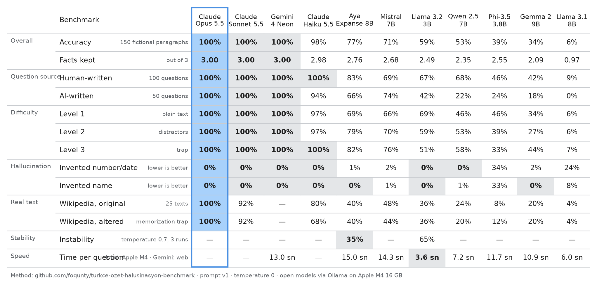
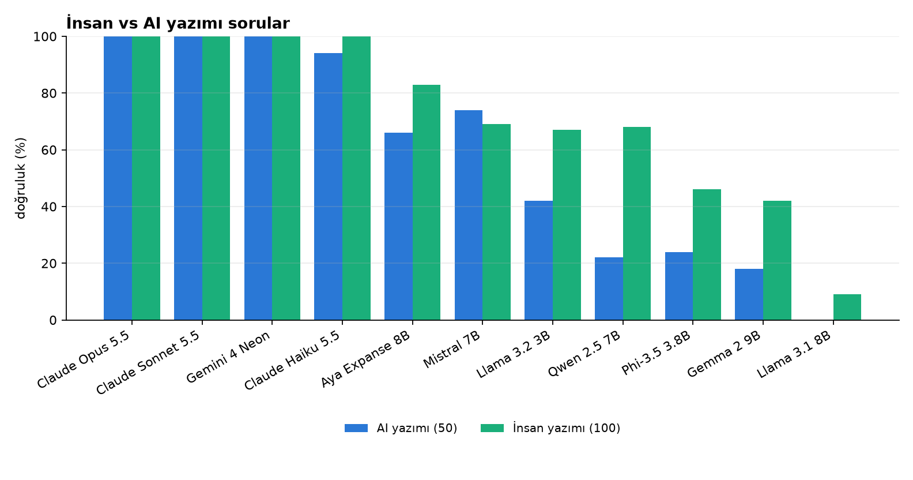
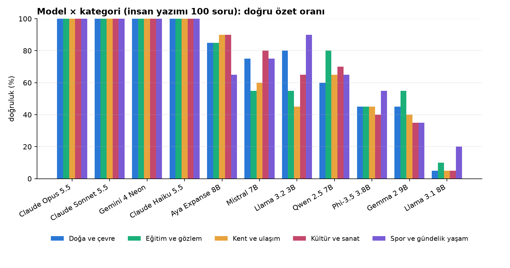
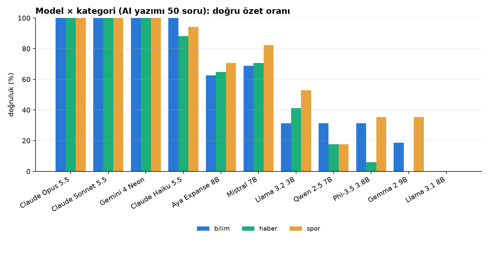
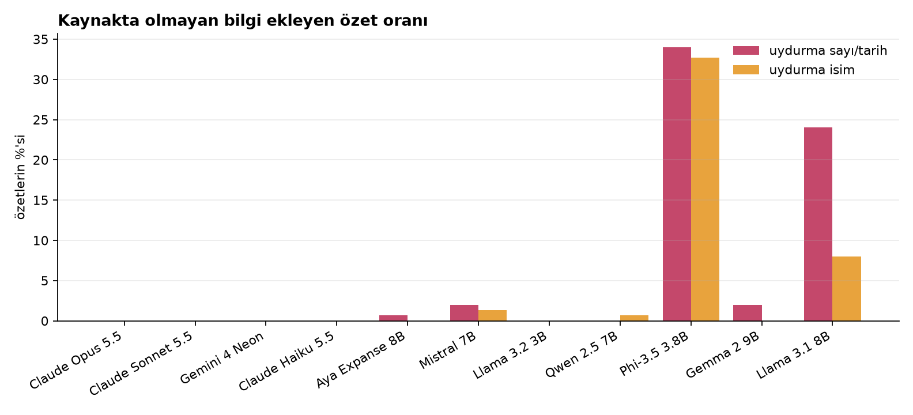
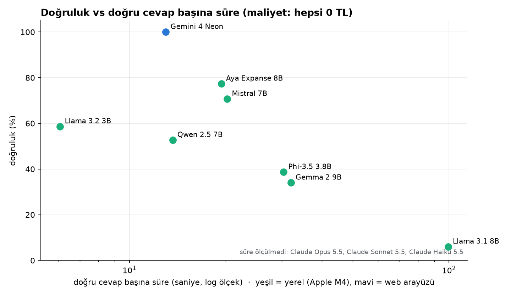

# Turkish Summary + Hallucination Benchmark

[Türkçe](README.md) · **English**

> When an LLM summarizes a Turkish paragraph, **does it keep the critical facts (number, date, name), or does it make them up?**

The questions are hidden (Hugging Face gated dataset); the scores and the code are public. 50 of the 100 human questions were added to a shared public benchmark; scores on the still-hidden part are reported separately.
**HF dataset:** [huggingface.co/datasets/foqunty/turkce-ozet-halusinasyon](https://huggingface.co/datasets/foqunty/turkce-ozet-halusinasyon) *(gated, manual approval)*

---

## Goal

Summarization is one of the most common things people use models for. But a fluent summary is not always a correct one. A changed number ("43 million" → "34 million") or a name that is not in the source is an error the reader cannot notice. This benchmark measures exactly that: critical facts in **Turkish** text that can be checked **by code**.

## Task

Each question is a short Turkish paragraph with 3 critical facts: a number, a date and a name. The model summarizes the paragraph in 2-3 sentences.

| metric | how |
|---|---|
| **facts** | how many of the 3 critical facts appear correctly in the summary (date formats, thousands separators, "yüzde 45" = "%45" and Turkish suffixes are normalized) |
| **invented number/date** | any number in the summary that is not in the source |
| **invented name** | any capitalized proper noun mid-sentence that is not in the source |
| **correct** | 3/3 facts **and** nothing invented |
| **meaning drift** | 20 answers are graded by two separate judge models (Sonnet 5.5, Opus 5.5) without seeing each other → judge agreement and comparison with the code |

Scoring is done by code from the raw output, not from the screen: [`scripts/puanla.py`](scripts/puanla.py).

## What was sent to the model?

Every model got **the exact same prompt** (prompt `v1`). `{paragraf}` was replaced with the text of each question:

```text
Aşağıdaki paragrafı Türkçe olarak 2-3 cümleyle özetle. Yalnızca paragrafta geçen bilgileri kullan; sayıları, tarihleri ve isimleri değiştirme, yeni bilgi ekleme. Sadece özeti yaz.

Paragraf:
{paragraf}
```

In English: *"Summarize the paragraph below in Turkish in 2-3 sentences. Use only information from the paragraph; do not change numbers, dates or names, and do not add new information. Write only the summary."*

There is no system prompt and no few-shot examples. The real questions are hidden, so the example below is a format example written outside the set ([`data/ornek.csv`](data/ornek.csv)).

**Example text (difficulty 1, news):**

> Kurgusal Akçay Belediyesi, ilçenin ilk kreşini **4 Mart 2025**'te açtı. Kreşte **60** çocuk için yer bulunuyor. Belediye Başkanı **Gönül Ertaş**, ikinci kreşin gelecek yıl açılacağını söyledi. Kreşin yapımı yaklaşık on ay sürdü.

*(The fictional Akçay municipality opened the district's first nursery on 4 March 2025. It has room for 60 children. Mayor Gönül Ertaş said a second nursery will open next year. Construction took about ten months.)*

**Answer key:** `4 Mart 2025; 60; Gönül Ertaş`

| model summary | result | why |
|---|---|---|
| Akçay Belediyesi ilk kreşini 4 Mart 2025'te açtı. 60 çocukluk kreşin ikincisinin gelecek yıl açılacağını Başkan Gönül Ertaş duyurdu. | correct | all 3 facts present, nothing invented |
| Akçay Belediyesi 04.03.2025'te ilk kreşini açtı; 60 çocuk kapasiteli. Başkan Ertaş ikinci kreşi müjdeledi. | correct | different date format, same date; the surname alone is enough |
| Akçay'da ilk kreş açıldı, 60 çocuk kapasiteli. Başkan Gönül Ertaş ikinci kreşin gelecek yıl açılacağını söyledi. | wrong | date missing |
| Akçay Belediyesi ilk kreşini 4 Mart 2025'te açtı. 80 çocukluk kreşi Başkan Gönül Ertaş ve Müdür Ali Kaya tanıttı. | wrong | wrote 80 instead of 60; "Ali Kaya" is not in the text |

**Hard example (difficulty 3):** a match ends 1-1 on the pitch, but the federation awards it 3-0. The key is `3-0; 9 Nisan 2025; Orçun Talay`. A model that only writes "1-1" gave the pitch score, so it is wrong.

## What did we require from the text? (question writing rules)

Every paragraph meets these rules; [`scripts/kontrol.py`](scripts/kontrol.py) checks them automatically:

| rule | why |
|---|---|
| Turkish, 200–1200 characters, 3–6 sentences | enough for a 2-3 sentence summary, but long enough that the model has to choose what matters |
| Exactly **3 critical facts**: a number, a date, a name | all three can be checked exactly by code |
| Each fact appears in the paragraph **word for word** | the answer key needs no interpretation |
| The paragraph also has non-critical details (duration, place, a second number) | the model has to pick what is important; extra numbers also make invented ones harder to spot |
| People, places and organizations are **fictional** | the model cannot answer from memory, only from the text (contamination guard) |
| Difficulty 3 has a **trap**: a corrected number, two people with the same surname, a value that contradicts world knowledge, several dates, percent vs. percentage point | when "faithful to the text" and "general knowledge" clash, which one does the model choose? |
| 5 categories in the human set, 3 in the AI set; 3 difficulty levels; at least 20% difficulty 3 | results should not depend on one type of text |

## What did we require from the summary? (scoring)

| requirement | details |
|---|---|
| All 3 facts in the summary | "4 Mart 2025" = "04.03.2025" = "4 Mart'ta (2025)"; "1.250" = "1250"; "yüzde 45" = "%45"; Turkish suffixes ("Ertaş'ın") and letter case are ignored; the surname is enough for a person |
| No invented numbers or dates | every number and date in the summary must be in the source |
| No invented names | every capitalized word in the middle of a sentence must appear in the source (month names excluded) |
| **Correct** = | 3/3 facts **and** zero invented items |

Length and style of the summary are not scored. The only thing measured is whether the critical facts are **carried over correctly**.

## Category and difficulty distribution

| set | categories | level 1 | level 2 | level 3 | total |
|---|---|---|---|---|---|
| **human** (`kaynak=insan`) | nature and environment · culture and art · city and transport · education and observation · sports and daily life (20 each) | 20 | 50 | 30 | **100** |
| **AI** (`kaynak=ai`, separate label) | news 17 · science 16 · sports 17 | 15 | 20 | 15 | **50** |

Both sets are 30% difficulty 3. **Level 2** paragraphs have distractors: a second number, a second date, or a non-critical name. **Level 3** paragraphs have a trap: a number corrected inside the text ("not 34, as first announced, but 43"), two people with the same surname, a value that contradicts world knowledge but is stated in the text (water boiling at 91 °C at high altitude), several dates, percent vs. percentage point.

All people, places and organizations are **fictional**, so a model cannot answer from memory, only from the text. This is also a guard against contamination.

## Conditions (the same for every model)

- Prompt `v1` ([`scripts/ortak.py`](scripts/ortak.py)), no system prompt, no examples.
- **Open models:** local via Ollama (Apple M4, 16 GB). One message per question, temperature 0, seed 42.
- **Claude models:** Claude Code subagents. Each agent started with a clean context, read only the prompt file and never saw the answer key. Temperature could not be set; time was not measured.
- **Gemini 4 Neon:** a new **temporary chat** for every question in the gemini.google.com web UI. Temperature could not be set. Code checked that every answer came from a one-message chat and belongs to the right paragraph. One answer was captured mid-sentence (before it had finished); that question was asked again in a new temporary chat and this is noted in the CSV. Time was measured in the web UI (from sending to the finished answer).
- Model version, date and access path are stored in the `not`, `tarih` and `erisim` columns of every answer.

## Results

*150 questions (100 human + 50 AI) · prompt v1 · 21–26 November 2026. Scored by code from the raw output.*



| # | model | company | open weights | accuracy (150) | human (100) | AI (50) | facts / 3 | summaries with invented items |
|---|---|---|---|---|---|---|---|---|
| 1 | Claude Opus 5.5 | Anthropic | | **100%** | 100% | 100% | 3.00 | 0% |
| 2 | Claude Sonnet 5.5 | Anthropic | | **100%** | 100% | 100% | 3.00 | 0% |
| 3 | Gemini 4 Neon | Google | | **100%** | 100% | 100% | 3.00 | 0% |
| 4 | Claude Haiku 5.5 | Anthropic | | **98%** | 100% | 94% | 2.98 | 0% |
| 5 | Aya Expanse 8B | Cohere | ✓ | **77%** | 83% | 66% | 2.76 | 1% |
| 6 | Mistral 7B | Mistral AI | ✓ | **71%** | 69% | 74% | 2.68 | 3% |
| 7 | Llama 3.2 3B | Meta | ✓ | **59%** | 67% | 42% | 2.49 | 0% |
| 8 | Qwen 2.5 7B | Alibaba | ✓ | **53%** | 68% | 22% | 2.35 | 1% |
| 9 | Phi-3.5 3.8B | Microsoft | ✓ | **39%** | 46% | 24% | 2.55 | 45% |
| 10 | Gemma 2 9B | Google | ✓ | **34%** | 42% | 18% | 2.09 | 2% |
| 11 | Llama 3.1 8B | Meta | ✓ | **6%** | 9% | 0% | 0.97 | 27% |

Breakdowns by category and difficulty: [`sonuclar/ozet.md`](sonuclar/ozet.md).

### Public subset and the still-hidden questions

50 of the 100 human questions (10 per category, difficulty 10/25/15) were added to a shared public benchmark repo: [nexa-lab-ai/nexa-bench](https://github.com/nexa-lab-ai/nexa-bench) (`sorular/foqunty.csv`, `foq-051`–`foq-100`). These questions can now leak into training data, so scores on the still-hidden part are reported separately:

| model | public 50 (human) | hidden 50 (human) | hidden 50 (AI) | hidden 100 |
|---|---|---|---|---|
| Claude Opus 5.5 | 100% | 100% | 100% | **100%** |
| Claude Sonnet 5.5 | 100% | 100% | 100% | **100%** |
| Gemini 4 Neon | 100% | 100% | 100% | **100%** |
| Claude Haiku 5.5 | 100% | 100% | 94% | **97%** |
| Aya Expanse 8B | 86% | 80% | 66% | **73%** |
| Mistral 7B | 70% | 68% | 74% | **71%** |
| Llama 3.2 3B | 66% | 68% | 42% | **55%** |
| Qwen 2.5 7B | 66% | 70% | 22% | **46%** |
| Phi-3.5 3.8B | 38% | 54% | 24% | **39%** |
| Gemma 2 9B | 38% | 46% | 18% | **32%** |
| Llama 3.1 8B | 10% | 8% | 0% | **4%** |

The two human halves give similar results (6 points apart on average for open models), so the split is balanced. For models added later, the main comparison should be the "hidden 100" column.

### Which was harder: human or AI questions?

**AI-written questions were harder.** Open models average 55% on human questions and 35% on AI questions. Seven models did better on the human set. Claude Opus, Sonnet and Gemini 4 Neon scored 100% on both, and Mistral 7B is the exception, doing better on the AI set (69% / 74%).

The gap most likely comes from **text density**, not from who wrote the text. AI paragraphs are longer (320 vs. 282 characters on average) and more crowded: 5.4 numbers and 4.9 proper names per paragraph, against 3.8 and 2.5 in the human set. Models write summaries of about the same length on both sets (23–33 words), so on dense text they have to fit more facts into the same word budget, and they drop facts. Qwen 2.5 7B drops at least one fact in 78% of AI questions and 32% of human questions. In this comparison, "who wrote it" and "how dense the text is" cannot be separated.






### Cost and time

Every run was free: open models locally, Claude and Gemini through subscription UIs. So the chart shows **time per correct answer** instead of cost. Times for open models average two runs. The second run (human questions) ran alongside other work and was slower.



### Experiment: real Wikipedia texts + memorization trap

25 Turkish Wikipedia texts on exam topics (CC BY-SA 4.0), each also in a version with one fact changed (`scripts/vikipedi_seti.py`, analysis in `scripts/ezber.py`). On the altered texts, none of the 10 models in this experiment (Gemini was not included) wrote the memorized real value (memorization = 0). Errors come from dropping and inventing facts, not from memory. Results: [`sonuclar/ozet_viki.md`](sonuclar/ozet_viki.md).

### Extra: repeat instability

Aya Expanse 8B and Llama 3.2 3B answered the same 20 questions (balanced sample, seed 42) 3 times each at **temperature 0.7**.

| model | run 1 / 2 / 3 correct | questions whose result changed | instability |
|---|---|---|---|
| Aya Expanse 8B | 13 / 13 / 13 (out of 20) | 7 | 35% |
| Llama 3.2 3B | 9 / 11 / 11 | 13 | 65% |

Aya's total stays the same across all three runs, but **which** questions it gets right changes on 7 of them. This is why the main results use temperature 0.

### Extra: meaning drift with LLM judges

The code measures **whether** a fact is in the summary. To measure meaning drift, 20 answers were sampled with a seed. Two separate judge models (Claude Sonnet 5.5 and Claude Opus 5.5) scored them 0–2 without seeing each other's scores. Details: [`sonuclar/ozet_hakem.md`](sonuclar/ozet_hakem.md).

| measure | result |
|---|---|
| exact agreement between judges (0/1/2) | 16/20 (80%), Cohen's κ = 0.64 |
| pass/fail agreement between judges | 17/20 (85%) |
| same decision as the code | 12/20 (Sonnet), 11/20 (Opus) |

The judges agree with each other but only about half the time with the code, because they measure different things. Some summaries the code marked wrong got full marks from the judges (Sonnet 4, Opus 3): a fact is missing, but nothing is false. In 4 summaries the code marked correct, both judges found meaning drift. For example, "the clouds got in the way" became "after the clouds passed", and cameras set up "in case an animal comes" were tied to a different purpose. Code-based scoring cannot catch this kind of error. Human scores are not added yet. Once `insan_puani` is filled in, `scripts/uyum.py` also computes human–judge agreement.

## Interpretation

1. Claude Opus, Claude Sonnet and Gemini 4 Neon got all 150 questions right, Haiku 147. The test is saturated for the best models. Telling them apart needs a stricter prompt ("at most 20 words") or longer texts.
2. Among open models, the best are Aya Expanse 8B (77%) and Mistral 7B (71%). Aya is the only model trained for 23 languages including Turkish, which likely explains the gap.
3. Errors fall into two types. Qwen, Gemma, Aya and Llama 3.2 **drop** facts but almost never invent. Phi-3.5 and Llama 3.1 **invent** numbers and names that are not in the text: 45% of Phi-3.5's summaries and 27% of Llama 3.1's contain invented items.
4. Model size alone does not decide. Llama 3.2 3B (59%) beat the larger Llama 3.1 8B (6%) and Gemma 2 9B (34%).
5. Categories differ little. Open models' category averages on the human set range from 50% to 58%. The hardest category is city and transport, the easiest sports and daily life.
6. The AI-set finding "hard questions are easier" did not repeat on the human set. On the AI set open models did better at level 3; on the human set level 1 is easiest (64%) and levels 2 and 3 are equal (53%). So the first finding depended on how the AI set was written, which is a reason not to generalize from a single set.
7. AI-written questions were harder (35% vs. 55% for open models), most likely because of text density (see above).
8. In the memorization trap no model wrote the memorized value. With the text in front of them, models follow the text; the real risk is dropping and inventing facts, not memory.
9. Code and judges catch different errors. The code sees missing facts, the judges see meaning drift. A reliable summary test should use both.

## How to run

```bash
cd benchmark
# 1) put the questions under data/ (hidden; not in this repo, request access on HF)
python scripts/kontrol.py                 # does the set follow the rules?

# 2) run models
python scripts/kos.py api --modeller qwen2.5-7b mistral-7b    # Ollama (local)
export OPENROUTER_API_KEY=...                                 # for API models
python scripts/kos.py manuel --model <web-model>              # prompt file for a web UI

# 3) score, charts and table
python scripts/puanla.py                  # → sonuclar/puanli.csv, sonuclar/ozet.md
pip install -r requirements.txt
python scripts/grafik.py                  # → grafikler/*.png
python scripts/tablo.py                   # → grafikler/5_karsilastirma*.png

# tests (no hidden set needed)
python scripts/test_ornek.py

# extras
SICAKLIK=0.7 python scripts/kos.py api --tekrar 3 --orneklem 20   # repeat / instability
python scripts/kos.py hakem --hakem-model sonnet-5.5 --n 20 && python scripts/uyum.py
```

All scripts use only the standard library, except `grafik.py` and `tablo.py`, which need matplotlib.

## Limitations

- The name check is heuristic: it looks at capitalized words and can give false positives. Every flag is visible in `puanli.csv` and can be checked by hand.
- If a model writes both the wrong and the right number ("not 34 but 43 million"), the code passes it. Meaning errors like this were measured separately with judge models.
- Temperature could not be set for Claude and Gemini. Open models ran at temperature 0.
- The human and AI sets use different categories, so compare categories within each set.
- Loss of details other than the 3 critical facts is not measured. This is a faithfulness test, not a summary-quality test.

## Files

```
data/ornek.csv          format example (real questions are hidden, in .gitignore)
scripts/ortak.py        prompt, CSV format, Turkish normalization
scripts/kos.py          runs models (ollama / openrouter / manual / judge)
scripts/puanla.py       code-based scoring + summary tables
scripts/grafik.py       charts
scripts/tablo.py        all metrics in one comparison table
scripts/kontrol.py      checks the question-set rules
scripts/test_ornek.py   scorer tests on public examples (runs in CI)
scripts/uyum.py         judge vs human agreement
scripts/hf_yukle.py     uploads the hidden set as a gated HF dataset
modeller.json           model list
sonuclar/ozet*.md       score tables (raw answers repeat the paragraphs, so they are not in the repo)
```
