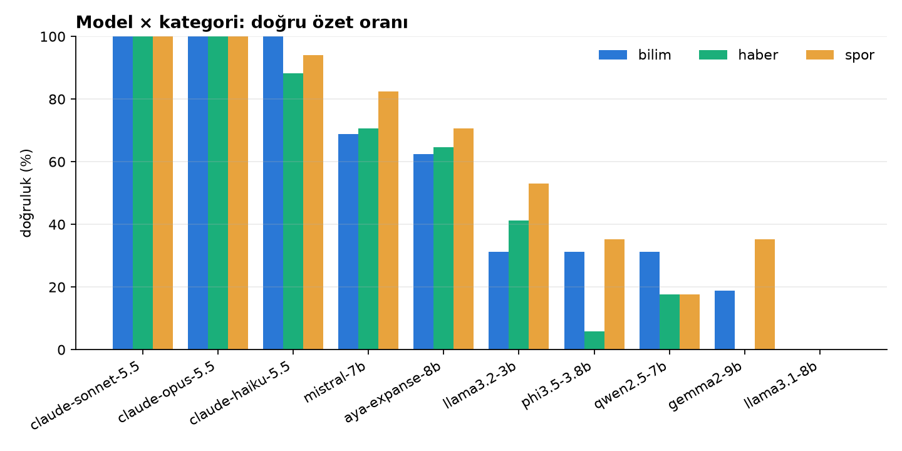
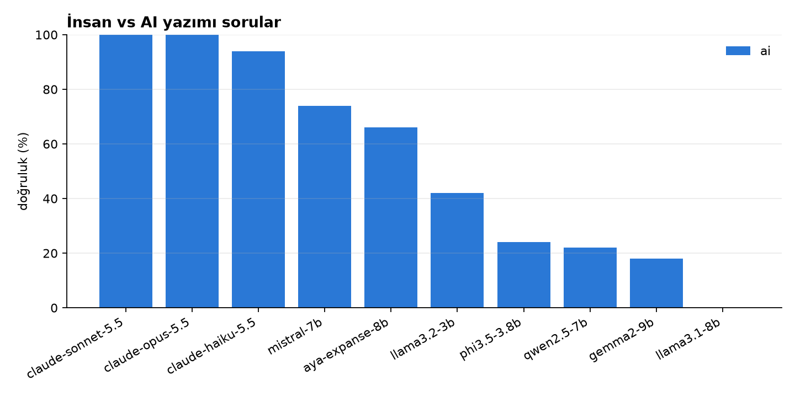
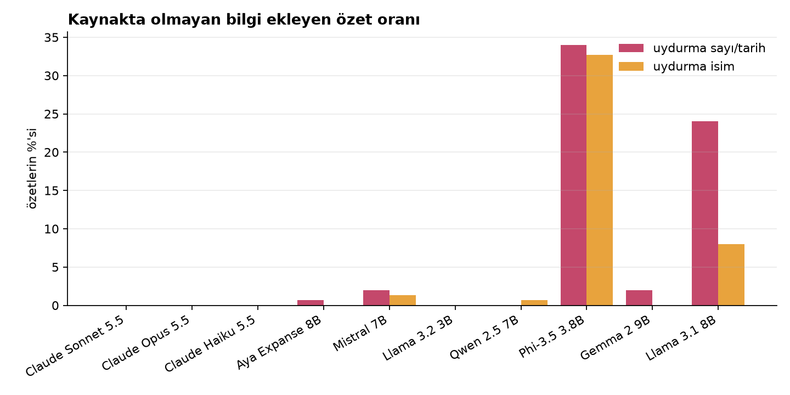

# Türkçe Özet + Halüsinasyon Benchmark'ı

> LLM'ler Türkçe bir paragrafı özetlerken **kritik bilgileri (sayı, tarih, isim) koruyor mu, yoksa uyduruyor mu?**

Sorular gizli (Hugging Face gated dataset), skorlar ve kod açık.
**HF dataset:** `https://huggingface.co/datasets/<hf-kullanici>/turkce-ozet-halusinasyon` *(erişim istekli)*

---

## Amaç

Özetleme, modellerin en çok kullanıldığı işlerden biri. Ama özetin akıcı olması doğru olduğu anlamına gelmiyor. Bir sayının değişmesi ("43 milyon" → "34 milyon") ya da kaynakta olmayan bir ismin eklenmesi, okuyan kişinin fark edemeyeceği bir hata. Bu benchmark tam olarak bunu ölçüyor: **Türkçe** metinde, **kodla** kontrol edilebilir kritik bilgiler.

## Görev

Her soru kısa bir Türkçe paragraf. İçinde 3 kritik bilgi var: bir sayı, bir tarih ve bir isim. Model paragrafı 2-3 cümleyle özetliyor.

| ölçüm | nasıl |
|---|---|
| **olgu** | 3 kritik bilgiden kaçı özette doğru geçiyor (tarih biçimi, binlik ayraç, "yüzde 45" = "%45", Türkçe ekler normalleştirilir) |
| **uydurma sayı/tarih** | özette olup kaynakta olmayan her rakam |
| **uydurma isim** | cümle ortasında büyük harfle geçen ve kaynakta olmayan özel isim |
| **doğru** | 3/3 bilgi var **ve** hiç uydurma yok |
| **anlam kayması** | 20 cevap hakem modele puanlatılır, aynı cevapları ben de puanlarım → uyum oranı |

Puanlama ekrandan değil, ham çıktıdan ve kodla yapılır: [`scripts/puanla.py`](scripts/puanla.py).

## Kategori ve zorluk dağılımı

| | zorluk 1 | zorluk 2 | zorluk 3 | toplam |
|---|---|---|---|---|
| haber | | | | |
| bilim | | | | |
| spor | | | | |
| **insan** | | | | **≥100** |
| **AI** (ayrı etiket) | 15 | 20 | 15 | **50** |

**Zorluk 3** soruların tuzağı var: metin içinde düzeltilen rakam ("ilk açıklanan 34 değil, 43"), aynı soyadlı iki kişi, dünya bilgisine ters düşen ama metinde açıkça yazan değer (yüksek rakımda suyun 91 °C'de kaynaması), birden çok tarih, yüzde ile yüzde puanının karışması.

Bütün kişi, yer ve kurumlar **kurgusaldır**. Böylece model ezberinden cevap üretemez, sadece metne bakabilir. Bu aynı zamanda kontaminasyona karşı bir önlem.

## Koşul (her model için aynı)

- İstem `v1` ([`scripts/ortak.py`](scripts/ortak.py)), sıcaklık 0, en fazla 400 token
- API modelleri OpenRouter üzerinden, yerel modeller Ollama ile, web arayüzü kullanılan modellerde her soru için yeni sohbet ve hafıza kapalı
- Model sürümü, tarih ve erişim yolu `sonuclar.csv`'nin `not`, `tarih`, `erisim` sütunlarında

## Sonuçlar

*İlk koşu · 21 Kasım 2025 · 50 AI sorusu · istem v1. Claude modelleri Claude Code alt ajanlarıyla, açık modeller Ollama ile (Apple M4, 16 GB, sıcaklık 0) koşuldu. Açık modeller: Qwen 2.5 7B, Llama 3.1 8B, Llama 3.2 3B, Gemma 2 9B, Mistral 7B, Phi-3.5, Aya Expanse 8B. ChatGPT henüz eklenmedi.*
| model | doğruluk | olgu (3 üzerinden) | uydurma sayı | uydurma isim | sn/soru | $ toplam | n |
|---|---|---|---|---|---|---|---|
| aya-expanse-8b | **66%** | 2.62 | 0% | 0% | 7.0 | 0.0000 | 50 |
| claude-haiku-5.5 | **94%** | 2.94 | 0% | 0% | – | 0.0000 | 50 |
| claude-opus-5.5 | **100%** | 3.00 | 0% | 0% | – | 0.0000 | 50 |
| claude-sonnet-5.5 | **100%** | 3.00 | 0% | 0% | – | 0.0000 | 50 |
| gemma2-9b | **18%** | 1.88 | 0% | 0% | 6.3 | 0.0000 | 50 |
| llama3.1-8b | **0%** | 0.78 | 46% | 22% | 3.9 | 0.0000 | 50 |
| llama3.2-3b | **42%** | 2.26 | 0% | 0% | 3.0 | 0.0000 | 50 |
| mistral-7b | **74%** | 2.72 | 4% | 2% | 10.8 | 0.0000 | 50 |
| phi3.5-3.8b | **24%** | 2.32 | 48% | 46% | 10.7 | 0.0000 | 50 |
| qwen2.5-7b | **22%** | 1.98 | 0% | 2% | 4.3 | 0.0000 | 50 |

### Kategoriye göre doğruluk

| model | bilim | haber | spor |
|---|---|---|---|
| aya-expanse-8b | 62% | 65% | 71% |
| claude-haiku-5.5 | 100% | 88% | 94% |
| claude-opus-5.5 | 100% | 100% | 100% |
| claude-sonnet-5.5 | 100% | 100% | 100% |
| gemma2-9b | 19% | 0% | 35% |
| llama3.1-8b | 0% | 0% | 0% |
| llama3.2-3b | 31% | 41% | 53% |
| mistral-7b | 69% | 71% | 82% |
| phi3.5-3.8b | 31% | 6% | 35% |
| qwen2.5-7b | 31% | 18% | 18% |

### Zorluğa göre doğruluk

| model | 1 | 2 | 3 |
|---|---|---|---|
| aya-expanse-8b | 40% | 65% | 93% |
| claude-haiku-5.5 | 93% | 90% | 100% |
| claude-opus-5.5 | 100% | 100% | 100% |
| claude-sonnet-5.5 | 100% | 100% | 100% |
| gemma2-9b | 13% | 5% | 40% |
| llama3.1-8b | 0% | 0% | 0% |
| llama3.2-3b | 40% | 60% | 20% |
| mistral-7b | 67% | 70% | 87% |
| phi3.5-3.8b | 20% | 25% | 27% |
| qwen2.5-7b | 7% | 15% | 47% |

### İnsan vs AI soruları

| model | ai |
|---|---|
| aya-expanse-8b | 66% |
| claude-haiku-5.5 | 94% |
| claude-opus-5.5 | 100% |
| claude-sonnet-5.5 | 100% |
| gemma2-9b | 18% |
| llama3.1-8b | 0% |
| llama3.2-3b | 42% |
| mistral-7b | 74% |
| phi3.5-3.8b | 24% |
| qwen2.5-7b | 22% |

### Deney: gerçek Vikipedi metinleri + ezber tuzağı

25 KPSS konulu Türkçe Vikipedi metni (CC BY-SA 4.0) ve her birinin tek bilgisi değiştirilmiş hâli (`data/deney_vikipedi.csv`, `scripts/vikipedi_seti.py`). Ezber analizi: `python3 scripts/ezber.py`. Sonuç: 10 modelin hiçbiri değiştirilmiş metinde ezberdeki gerçek değeri yazmadı (ezber = 0); hatalar atlama ve uydurma.

| model | doğruluk | olgu (3 üzerinden) | uydurma sayı | uydurma isim | sn/soru | $ toplam | n |
|---|---|---|---|---|---|---|---|
| aya-expanse-8b | **40%** | 2.18 | 0% | 4% | 7.5 | 0.0000 | 50 |
| claude-haiku-5.5 | **74%** | 2.68 | 0% | 0% | – | 0.0000 | 50 |
| claude-opus-5.5 | **100%** | 3.00 | 0% | 0% | – | 0.0000 | 50 |
| claude-sonnet-5.5 | **92%** | 2.90 | 0% | 0% | – | 0.0000 | 50 |
| gemma2-9b | **20%** | 1.64 | 0% | 6% | 7.2 | 0.0000 | 50 |
| llama3.1-8b | **4%** | 0.62 | 28% | 14% | 4.1 | 0.0000 | 50 |
| llama3.2-3b | **36%** | 2.06 | 0% | 4% | 3.5 | 0.0000 | 50 |
| mistral-7b | **46%** | 2.42 | 0% | 8% | 14.6 | 0.0000 | 50 |
| phi3.5-3.8b | **10%** | 2.00 | 48% | 20% | 9.6 | 0.0000 | 50 |
| qwen2.5-7b | **22%** | 1.66 | 4% | 2% | 4.3 | 0.0000 | 50 |

### Ek: tekrar kararsızlığı

Aya Expanse 8B ve Llama 3.2 3B, aynı 20 soruyu (dengeli örneklem, tohum 42) **sıcaklık 0.7** ile 3'er kez çözdü (`SICAKLIK=0.7 python3 scripts/kos.py api --tekrar 3 --orneklem 20`).

| model | deneme 1 / 2 / 3 doğru | sonucu değişen soru | kararsızlık |
|---|---|---|---|
| aya-expanse-8b | 13 / 13 / 13 (20 üzerinden) | 7 | %35 |
| llama3.2-3b | 9 / 11 / 11 | 13 | %65 |

Aya'nın toplam skoru üç denemede de aynı (13/20), ama **hangi** soruları doğru yaptığı 7 soruda değişiyor. Tek bir koşunun skoru sabit görünse bile soru düzeyinde sonuç şansa bağlı. Bu yüzden ana sonuçlar sıcaklık 0 ile alındı ve tek koşu, tek ölçüm olarak okunmamalı.






## Yorum

Claude modelleri açık farkla önde: Sonnet ve Opus 50/50, Haiku 47/50 yaptı. Açık modellerde en iyiler Mistral 7B (37/50) ve Türkçe dahil 23 dil için eğitilmiş Aya Expanse 8B (33/50). Hatalar iki türe ayrılıyor. Qwen, Gemma, Aya ve Llama 3.2 bilgiyi atlıyor ama neredeyse hiç uydurmuyor. Llama 3.1 8B ve Phi-3.5 ise metinde olmayan isim, rakam ve tarih yazıyor; Llama 3.1 hiçbir soruyu doğru yapamadı ve özetlerinin %54'ünde uydurma var. Model boyutu tek başına belirleyici değil: Llama 3.2 3B (21/50), kendinden büyük Llama 3.1 8B'yi (0/50) açık ara geçti. Kısa özet yazan modeller önce isimleri, sonra tarihleri atıyor. Claude ise metnin %92–94'ünü koruyor, yani test Claude için doymuş durumda; istem v2 ("en fazla 20 kelime") ile yeniden ayırt edici hale getirilmeli. Şaşırtıcı bulgu: açık modeller "zor" (z3) sorularda daha başarılı. Zor sorularda kritik bilgi paragrafın ana konusu; kolay sorularda isim kenarda kalıyor ve kısaltırken ilk o atılıyor. Gerçek Vikipedi metinleriyle kurulan ezber tuzağında (bilgiyi değiştirilmiş metin) 10 modelin hiçbiri ezberdeki doğru değeri yazmadı. Yani metin önündeyken modeller metne uyuyor; asıl risk ezber değil, uydurma. İnsan soruları henüz eklenmediği için insan ve AI karşılaştırması bekliyor.

## Nasıl koşulur

```bash
# 1) soruları data/ altına koy (gizli; repoda yok, HF'ten erişim iste)
python scripts/kontrol.py                 # set kurallara uyuyor mu?

# 2) modelleri koş
export OPENROUTER_API_KEY=sk-or-...
python scripts/kos.py api --modeller hepsi
python scripts/kos.py manuel --model gemini-4-carbon-web   # web arayüzü için istem dosyası

# 3) puanla + grafik
python scripts/puanla.py                  # → sonuclar/puanli.csv, sonuclar/ozet.md
pip install -r requirements.txt
python scripts/grafik.py                  # → grafikler/*.png

# ekler
python scripts/kos.py api --modeller sonnet-5.5 --tekrar 3 --orneklem 20   # tekrar / kararsızlık
python scripts/kos.py hakem --hakem-model sonnet-5.5 --n 20 && python scripts/uyum.py
```

Betiklerin hepsi standart kütüphaneyle çalışır, yalnızca `grafik.py` matplotlib ister.

## Sınırlamalar

- İsim kontrolü sezgisel: büyük harfle başlayan kelimeye bakar, yanlış pozitif verebilir. `puanli.csv`'de her uydurma işareti görünür ve elle kontrol edilebilir.
- Model hem yanlış hem doğru rakamı yazarsa ("34 değil 43 milyon") kod geçer verir. Bu tür anlam hatalarını hakem modelle ayrıca ölçüyorum.
- 3 kritik bilgi dışındaki ayrıntıların kaybı ölçülmüyor. Bu bir sadakat testi, özet kalitesi testi değil.

## Dosyalar

```
data/ornek.csv          biçim örneği (gerçek sorular gizli, .gitignore'da)
scripts/ortak.py        istem, CSV biçimi, Türkçe normalleştirme
scripts/kos.py          modelleri koşar (openrouter / ollama / manuel / hakem)
scripts/puanla.py       kodla puanlama + özet tablolar
scripts/grafik.py       grafikler
scripts/kontrol.py      soru seti kurallarını denetler
scripts/uyum.py         hakem model ile insan puanının uyumu
modeller.json           model listesi
sonuclar/               ham cevaplar ve puanlar
```
