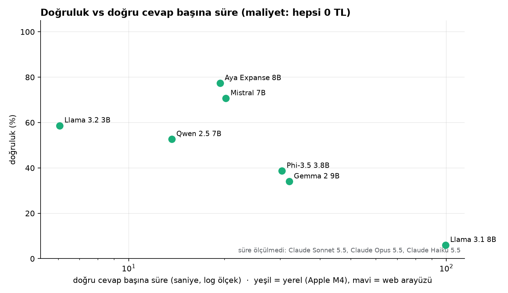

# Türkçe Özet + Halüsinasyon Benchmark'ı

**Türkçe** · [English](README.en.md)

> LLM'ler Türkçe bir paragrafı özetlerken **kritik bilgileri (sayı, tarih, isim) koruyor mu, yoksa uyduruyor mu?**

Sorular gizli (Hugging Face gated dataset), skorlar ve kod açık.
**HF dataset:** [huggingface.co/datasets/foqunty/turkce-ozet-halusinasyon](https://huggingface.co/datasets/foqunty/turkce-ozet-halusinasyon) *(erişim istekli, elle onay)*

---

## Amaç

Özetleme, modellerin en çok kullanıldığı işlerden biri. Ama özetin akıcı olması doğru olduğu anlamına gelmiyor. Bir sayının değişmesi ("43 milyon" → "34 milyon") ya da kaynakta olmayan bir ismin eklenmesi, okuyan kişinin fark edemeyeceği bir hata. Bu benchmark tam olarak bunu ölçüyor: **Türkçe** metinde, **kodla** kontrol edilebilir kritik bilgiler.

## Görev

Her soru kısa bir Türkçe paragraf. İçinde 3 kritik bilgi var: bir sayı, bir tarih ve bir isim. Model paragrafı 2-3 cümleyle özetliyor.

| ölçüm | nasıl |
|---|---|
| **olgu** | 3 kritik bilgiden kaçı özette doğru geçiyor (tarih biçimi, binlik ayraç, "yüzde 45" = "%45", Türkçe ekler normalleştirilir) |
| **uydurma sayı/tarih** | özette olup kaynakta olmayan her rakam |
| **uydurma isim** | cümle ortasında büyük harfle geçen ve kaynakta olmayan özel isim |
| **doğru** | 3/3 bilgi var **ve** hiç uydurma yok |
| **anlam kayması** | 20 cevap iki ayrı hakem modele (Sonnet 5.5, Opus 5.5) birbirini görmeden puanlatılır → hakem uyumu ve kodla karşılaştırma |

Puanlama ekrandan değil, ham çıktıdan ve kodla yapılır: [`scripts/puanla.py`](scripts/puanla.py).

## Modele ne gönderildi?

Her modele kelimesi kelimesine **aynı istem** gitti (istem `v1`). `{paragraf}` yerine her seferinde o sorunun metni yazıldı:

```text
Aşağıdaki paragrafı Türkçe olarak 2-3 cümleyle özetle. Yalnızca paragrafta geçen bilgileri kullan; sayıları, tarihleri ve isimleri değiştirme, yeni bilgi ekleme. Sadece özeti yaz.

Paragraf:
{paragraf}
```

Sistem istemi yok, örnek (few-shot) yok. Gerçek sorular gizli olduğu için aşağıdaki örnek, setin dışında yazılmış bir biçim örneğidir ([`data/ornek.csv`](data/ornek.csv)).

**Örnek metin (zorluk 1, haber):**

> Kurgusal Akçay Belediyesi, ilçenin ilk kreşini **4 Mart 2025**'te açtı. Kreşte **60** çocuk için yer bulunuyor. Belediye Başkanı **Gönül Ertaş**, ikinci kreşin gelecek yıl açılacağını söyledi. Kreşin yapımı yaklaşık on ay sürdü.

**Cevap anahtarı:** `4 Mart 2025; 60; Gönül Ertaş`

| model özeti | sonuç | neden |
|---|---|---|
| Akçay Belediyesi ilk kreşini 4 Mart 2025'te açtı. 60 çocukluk kreşin ikincisinin gelecek yıl açılacağını Başkan Gönül Ertaş duyurdu. | doğru | 3 bilgi de var, uydurma yok |
| Akçay Belediyesi 04.03.2025'te ilk kreşini açtı; 60 çocuk kapasiteli. Başkan Ertaş ikinci kreşi müjdeledi. | doğru | tarih biçimi farklı ama aynı; soyadı tek başına yeterli |
| Akçay'da ilk kreş açıldı, 60 çocuk kapasiteli. Başkan Gönül Ertaş ikinci kreşin gelecek yıl açılacağını söyledi. | yanlış | tarih yok |
| Akçay Belediyesi ilk kreşini 4 Mart 2025'te açtı. 80 çocukluk kreşi Başkan Gönül Ertaş ve Müdür Ali Kaya tanıttı. | yanlış | 60 yerine 80 yazmış; "Ali Kaya" metinde yok |

**Zor (zorluk 3) örnek:** maç sahada 1-1 biter ama federasyon 3-0 hükmen tescil eder. Anahtar `3-0; 9 Nisan 2025; Orçun Talay`. Özette yalnızca "1-1" yazan model, saha skorunu verdiği için yanlış sayılır.

## Metinden ne istedik? (soru yazım kuralları)

Her paragraf şu şartları sağlıyor; [`scripts/kontrol.py`](scripts/kontrol.py) bunları otomatik denetliyor:

| kural | neden |
|---|---|
| Türkçe, 200–1200 karakter, 3–6 cümle | 2-3 cümlelik özet için yeterli bilgi, ama bilgiyi seçmeyi gerektirecek kadar uzun |
| Tam **3 kritik bilgi**: bir sayı, bir tarih, bir isim | üçü de kodla kesin kontrol edilebilir |
| Her bilgi paragrafta **bire bir** geçiyor | cevap anahtarı yorum gerektirmez |
| Paragrafta kritik olmayan ek bilgiler de var (süre, yer, ikinci bir rakam) | modelin neyin önemli olduğunu seçmesi gerekir; ek rakamlar uydurma tespitini de zorlaştırır |
| Kişi, yer ve kurumlar **kurgusal** | model cevabı ezberinden veremez, sadece metne bakabilir (kontaminasyon önlemi) |
| Zorluk 3'te bir **tuzak**: düzeltilen rakam, aynı soyadlı iki kişi, dünya bilgisine ters düşen değer, birden çok tarih, yüzde/yüzde puanı | "metne sadakat" ile "genel bilgi" çatıştığında model hangisini seçiyor? |
| İnsan setinde 5, AI setinde 3 kategori; 3 zorluk; en az %20'si zorluk 3 | sonuçlar tek bir türe bağlı kalmasın |

## Özetten ne istedik? (puanlama)

| şart | ayrıntı |
|---|---|
| 3 bilginin üçü de özette | "4 Mart 2025" = "04.03.2025" = "4 Mart'ta (2025)"; "1.250" = "1250"; "yüzde 45" = "%45"; Türkçe ekler ("Ertaş'ın") ve büyük/küçük harf yok sayılır; kişi için soyadı yeterli |
| Uydurma rakam/tarih yok | özetteki her sayı ve tarih kaynakta olmalı |
| Uydurma isim yok | cümle ortasında büyük harfle geçen her kelimenin kaynakta karşılığı olmalı (ay adları hariç) |
| **Doğru** = | 3/3 bilgi **ve** sıfır uydurma |

Özetin uzunluğu ya da üslubu puanlanmıyor. Ölçülen tek şey kritik bilgilerin **doğru aktarılması**.

## Kategori ve zorluk dağılımı

| set | kategoriler | zorluk 1 | zorluk 2 | zorluk 3 | toplam |
|---|---|---|---|---|---|
| **insan** (`kaynak=insan`) | doğa ve çevre · kültür ve sanat · kent ve ulaşım · eğitim ve gözlem · spor ve gündelik yaşam (20'şer) | 20 | 50 | 30 | **100** |
| **AI** (`kaynak=ai`, ayrı etiket) | haber 17 · bilim 16 · spor 17 | 15 | 20 | 15 | **50** |

Zorluk 3 oranı iki sette de %30. **Zorluk 2** paragraflarda çeldirici var: ikinci bir rakam, ikinci bir tarih, ya da kritik olmayan bir isim. **Zorluk 3** paragraflarda tuzak var: metin içinde düzeltilen rakam ("ilk açıklanan 34 değil, 43"), aynı soyadlı iki kişi, dünya bilgisine ters düşen ama metinde açıkça yazan değer (yüksek rakımda suyun 91 °C'de kaynaması), birden çok tarih, yüzde ile yüzde puanının karışması.

Bütün kişi, yer ve kurumlar **kurgusaldır**. Böylece model ezberinden cevap üretemez, sadece metne bakabilir. Bu aynı zamanda kontaminasyona karşı bir önlem.

## Koşul (her model için aynı)

- İstem `v1` ([`scripts/ortak.py`](scripts/ortak.py)), sistem istemi yok, örnek yok.
- **Açık modeller:** Ollama ile yerelde (Apple M4, 16 GB). Her soru ayrı bir mesaj, sıcaklık 0, tohum 42.
- **Claude modelleri:** Claude Code alt ajanları. Her ajan temiz bağlamla başladı, sadece istem dosyasını okudu, cevap anahtarını görmedi. Sıcaklık ayarlanamadı, süre ölçülmedi.
- **Gemini 4 Neon:** gemini.google.com web arayüzünde her soru için yeni bir **geçici sohbet**. Sıcaklık ayarlanamadı. Her cevabın tek mesajlık bir sohbetten geldiği ve doğru paragrafa ait olduğu kodla kontrol edildi.
- Model sürümü, tarih ve erişim yolu her cevabın `not`, `tarih` ve `erisim` sütunlarında kayıtlı.

## Sonuçlar

*150 soru (100 insan + 50 AI) · istem v1 · 21–26 Kasım 2026. Puanlar ham çıktıdan, kodla.*


| # | model | firma | açık ağırlık | doğruluk (150) | insan (100) | AI (50) | olgu / 3 | uydurma içeren özet |
|---|---|---|---|---|---|---|---|---|
| 1 | Claude Opus 5.5 | Anthropic | | **100%** | 100% | 100% | 3.00 | 0% |
| 2 | Claude Sonnet 5.5 | Anthropic | | **100%** | 100% | 100% | 3.00 | 0% |
| 3 | Claude Haiku 5.5 | Anthropic | | **98%** | 100% | 94% | 2.98 | 0% |
| 4 | Aya Expanse 8B | Cohere | ✓ | **77%** | 83% | 66% | 2.76 | 1% |
| 5 | Mistral 7B | Mistral AI | ✓ | **71%** | 69% | 74% | 2.68 | 3% |
| 6 | Llama 3.2 3B | Meta | ✓ | **59%** | 67% | 42% | 2.49 | 0% |
| 7 | Qwen 2.5 7B | Alibaba | ✓ | **53%** | 68% | 22% | 2.35 | 1% |
| 8 | Phi-3.5 3.8B | Microsoft | ✓ | **39%** | 46% | 24% | 2.55 | 45% |
| 9 | Gemma 2 9B | Google | ✓ | **34%** | 42% | 18% | 2.09 | 2% |
| 10 | Llama 3.1 8B | Meta | ✓ | **6%** | 9% | 0% | 0.97 | 27% |
| – | Gemini 4 Neon | Google | | *koşu sürüyor* | | | | |

Kategori ve zorluk kırılımları: [`sonuclar/ozet.md`](sonuclar/ozet.md).

### Hangisi daha zor çıktı: insan mı, AI mı?

**AI yazımı sorular daha zor çıktı.** Açık modellerin ortalaması insan sorularında %55, AI sorularında %35. Yedi model insan setinde daha iyi yaptı. Claude Opus ve Sonnet iki sette de %100 aldı, Mistral 7B ise tersine AI setinde daha iyi (69% / 74%).

Fark büyük ihtimalle yazarın kim olduğundan değil, **metnin yoğunluğundan** geliyor. AI paragrafları daha uzun (ortalama 320 / 282 karakter) ve daha kalabalık: paragraf başına 5,4 sayı ve 4,9 özel isim var, insan setinde 3,8 ve 2,5. Modeller iki sette de yaklaşık aynı uzunlukta özet yazıyor (23–33 kelime). Bu yüzden yoğun metinde aynı kelime bütçesine daha çok bilgi sığdırmaları gerekiyor ve bilgi atlıyorlar. Qwen 2.5 7B'nin bilgi atlama oranı AI setinde %78, insan setinde %32. Yani bu karşılaştırmada "kim yazdı" ile "metin ne kadar yoğun" birbirinden ayrılamıyor.


### Maliyet ve süre

Bütün koşular ücretsiz: açık modeller yerelde, Claude ve Gemini abonelik arayüzünden. Bu yüzden maliyet yerine **doğru cevap başına süre** gösteriliyor. Açık modellerin süreleri iki koşunun ortalaması. İkinci koşu (insan soruları) başka işlerle eşzamanlı çalıştığı için daha yavaş.



### Deney: gerçek Vikipedi metinleri + ezber tuzağı

25 KPSS konulu Türkçe Vikipedi metni (CC BY-SA 4.0) ve her birinin tek bilgisi değiştirilmiş hâli kullanıldı (`scripts/vikipedi_seti.py`, ezber analizi `scripts/ezber.py`). Değiştirilmiş metinde 10 modelin hiçbiri ezberdeki gerçek değeri yazmadı (ezber = 0). Hatalar ezberden değil, bilgi atlamaktan ve uydurmaktan geliyor. Sonuçlar: [`sonuclar/ozet_viki.md`](sonuclar/ozet_viki.md).

### Ek: tekrar kararsızlığı

Aya Expanse 8B ve Llama 3.2 3B, aynı 20 soruyu (dengeli örneklem, tohum 42) **sıcaklık 0.7** ile 3'er kez çözdü.

| model | deneme 1 / 2 / 3 doğru | sonucu değişen soru | kararsızlık |
|---|---|---|---|
| Aya Expanse 8B | 13 / 13 / 13 (20 üzerinden) | 7 | %35 |
| Llama 3.2 3B | 9 / 11 / 11 | 13 | %65 |

Aya'nın toplam skoru üç denemede de aynı, ama **hangi** soruları doğru yaptığı 7 soruda değişiyor. Bu yüzden ana sonuçlar sıcaklık 0 ile alındı.

### Ek: hakem modeli ile anlam kayması

Kod, bilginin özette **olup olmadığını** ölçüyor. Anlamın kayıp kaymadığını ölçmek için 20 cevap tohumla seçildi. İki ayrı hakem model (Claude Sonnet 5.5 ve Claude Opus 5.5), birbirinin puanını görmeden bu cevapları 0–2 arası puanladı. Ayrıntı: [`sonuclar/ozet_hakem.md`](sonuclar/ozet_hakem.md).

| ölçüm | sonuç |
|---|---|
| iki hakem tam uyum (0/1/2) | 16/20 (%80), Cohen κ = 0.64 |
| iki hakem geçti/kaldı uyumu | 17/20 (%85) |
| kod ile hakem aynı karar | 12/20 (Sonnet), 11/20 (Opus) |

Hakemler birbiriyle uyuşuyor ama kodla ancak yarı yarıya uyuşuyor, çünkü farklı şeyleri ölçüyorlar. Kodun "yanlış" dediği özetlerin bir kısmına hakemler tam puan verdi (Sonnet 4, Opus 3): bu özetlerde bilgi eksik ama yanlış bir şey yok. Kodun "doğru" dediği 4 özette ise iki hakem de anlam kayması buldu. Örneğin "bulutlar araya girdi" ifadesi "bulutlar geçtikten sonra" olmuş, "hayvan gelirse diye kurulan kameralar" ise başka bir amaca bağlanmış. Bu, kod tabanlı puanlamanın yakalayamadığı bir hata türü. İnsan puanı henüz eklenmedi; `insan_puani` doldurulunca `scripts/uyum.py` insan ile hakem arasındaki uyumu da hesaplar.

## Yorum

1. Claude Opus ve Sonnet 150 sorunun hepsini doğru yaptı, Haiku 147'sini. Bu test en iyi modeller için doymuş durumda. Onları ayırmak için daha sıkı bir istem ("en fazla 20 kelime") ya da daha uzun metinler gerekiyor.
2. Açık modellerde en iyiler Aya Expanse 8B (%77) ve Mistral 7B (%71). Aya, Türkçe dahil 23 dil için eğitilmiş tek model ve fark muhtemelen buradan geliyor.
3. Hatalar iki türe ayrılıyor. Qwen, Gemma, Aya ve Llama 3.2 bilgiyi **atlıyor** ama neredeyse hiç uydurmuyor. Phi-3.5 ve Llama 3.1 ise metinde olmayan sayı ve isim **uyduruyor**: Phi-3.5 özetlerinin %45'inde, Llama 3.1'in %27'sinde uydurma var.
4. Model boyutu tek başına belirleyici değil. Llama 3.2 3B (%59), kendinden büyük Llama 3.1 8B'yi (%6) ve Gemma 2 9B'yi (%34) geçti.
5. Kategoriler arasında büyük fark yok. Açık modellerin insan setindeki kategori ortalamaları %50 ile %58 arasında. En zor kategori kent ve ulaşım, en kolayı spor ve gündelik yaşam.
6. AI setindeki "zor sorular daha kolay" bulgusu insan setinde tekrar etmedi. AI setinde açık modeller zorluk 3'te daha iyiydi; insan setinde zorluk 1 en kolay (%64), zorluk 2 ve 3 eşit (%53). Yani ilk bulgu AI setinin yazımına bağlıydı. Tek bir set üzerinden genelleme yapmamak gerektiğini gösteriyor.
7. AI yazımı sorular daha zor çıktı (açık modeller %35, insan sorularında %55). Bunun sebebi büyük ihtimalle metin yoğunluğu (yukarıdaki bölüm).
8. Ezber tuzağında hiçbir model ezberdeki değeri yazmadı. Metin önündeyken modeller metne uyuyor; asıl risk ezber değil, bilgiyi atlamak ve uydurmak.
9. Kod ve hakem farklı hataları yakalıyor. Kod eksik bilgiyi, hakem anlam kaymasını görüyor. Güvenilir bir özet testi için ikisi birlikte kullanılmalı.

## Nasıl koşulur

```bash
cd benchmark
# 1) soruları data/ altına koy (gizli; repoda yok, HF'ten erişim iste)
python scripts/kontrol.py                 # set kurallara uyuyor mu?

# 2) modelleri koş
python scripts/kos.py api --modeller qwen2.5-7b mistral-7b    # Ollama (yerel)
export OPENROUTER_API_KEY=...                                 # API ile koşulacak modeller için
python scripts/kos.py manuel --model <web-modeli>             # web arayüzü için istem dosyası

# 3) puanla, grafik ve tablo
python scripts/puanla.py                  # → sonuclar/puanli.csv, sonuclar/ozet.md
pip install -r requirements.txt
python scripts/grafik.py                  # → grafikler/*.png
python scripts/tablo.py                   # → grafikler/5_karsilastirma*.png

# testler (gizli set gerekmez)
python scripts/test_ornek.py

# ekler
SICAKLIK=0.7 python scripts/kos.py api --tekrar 3 --orneklem 20   # tekrar / kararsızlık
python scripts/kos.py hakem --hakem-model sonnet-5.5 --n 20 && python scripts/uyum.py
```

Betiklerin hepsi standart kütüphaneyle çalışır. Sadece `grafik.py` ve `tablo.py` matplotlib ister.

## Sınırlamalar

- İsim kontrolü sezgisel: büyük harfle başlayan kelimelere bakıyor ve yanlış pozitif verebilir. `puanli.csv`'de her uydurma işareti görünüyor, elle kontrol edilebilir.
- Model hem yanlış hem doğru rakamı yazarsa ("34 değil 43 milyon") kod geçer veriyor. Bu tür anlam hataları hakem modelle ayrıca ölçüldü.
- Claude ve Gemini'de sıcaklık ayarlanamadı. Açık modeller sıcaklık 0 ile koşuldu.
- İnsan ve AI setlerinin kategorileri farklı. Kategori karşılaştırması her set kendi içinde yapılmalı.
- 3 kritik bilgi dışındaki ayrıntıların kaybı ölçülmüyor. Bu bir sadakat testi, özet kalitesi testi değil.

## Dosyalar

```
data/ornek.csv          biçim örneği (gerçek sorular gizli, .gitignore'da)
scripts/ortak.py        istem, CSV biçimi, Türkçe normalleştirme
scripts/kos.py          modelleri koşar (ollama / openrouter / manuel / hakem)
scripts/puanla.py       kodla puanlama + özet tablolar
scripts/grafik.py       grafikler
scripts/tablo.py        bütün ölçümler tek karşılaştırma tablosunda
scripts/kontrol.py      soru seti kurallarını denetler
scripts/test_ornek.py   puanlayıcı testleri (herkese açık örneklerle)
scripts/uyum.py         hakem ile insan puanının uyumu
scripts/hf_yukle.py     gizli seti gated HF dataset olarak yükler
modeller.json           model listesi
sonuclar/ozet*.md       skor tabloları (ham cevaplar paragrafları tekrar ettiği için repoda yok)
```
