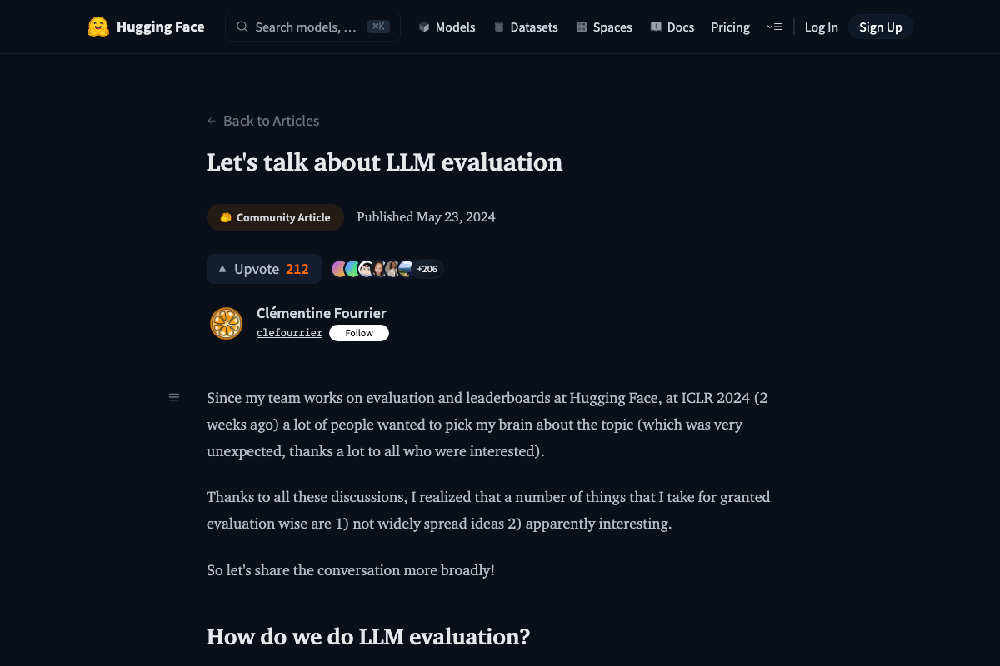

# Task 1 · Makale A3: "Let's talk about LLM evaluation"

Clémentine Fourrier, Hugging Face blogu, 23 Mayıs 2024 · <https://huggingface.co/blog/clefourrier/llm-evaluation>

## Özet

Fourrier, LLM değerlendirmesinin üç amacını ayırıyor: eğitim sırasında modelin gerilemediğini kontrol etmek, modelleri sıralamak ve bir modelin neler yapabildiğini anlamak. Bunun için üç yol karşılaştırıyor: otomatik benchmark'lar, insan değerlendiriciler ve hakem olarak kullanılan modeller. Benchmark'lar iyi tanımlanmış görevlerde işe yarıyor, ama "matematikte iyi" gibi geniş bir yetenek GSM8K gibi dar bir örneklemle ölçüldüğü için skoru yorumlamak zor; açık sorular eğitim verisine sızabiliyor (kontaminasyon), buna karşı canary dizgileri ve gated ya da şifreli veri setleri öneriliyor. İnsan değerlendirme açık uçlu işlere uyuyor, ama insanlar kendinden emin üsluba ve kendi görüşlerine yakın cevaplara kapılıyor; bu yüzden doğruluk gerektiren işlerde daha sağlam bir ölçümle desteklenmeli. Hakem modeller ölçekleniyor, ama kendi cevaplarını kayırabiliyor, puan aralıklarında tutarsız davranıyor ve fark edilmesi zor yanlılıklar taşıyor; yazara göre insan sıralamalarıyla uyumları da sanıldığı kadar yüksek değil. Skorlar istemdeki küçük değişikliklerle oynayabildiği için yazar ham skor yerine sıralamanın kararlılığına bakmayı öneriyor ve "genel yetenek" iddialarına temkinli yaklaşılması gerektiğini söylüyor.

## Sunum için madde: "Bu makaleden faydalandım"

- **Kontaminasyon:** Bütün kişi, yer ve kurumlar kurgusal; model cevabı ezberinden değil metinden çıkarmak zorunda. Gizli set, makalenin önerdiği gibi Hugging Face'te gated.
- **İstem hassasiyeti:** Her modele kelimesi kelimesine aynı istem (v1); açık modeller sıcaklık 0'da.
- **Üç yoldan ikisi birlikte:** Kritik bilgiler kodla, anlam kayması iki hakem modelle puanlandı. Hakemler birbirleriyle %80 uyuştu, kodla yaklaşık yarı yarıya; ikisi farklı hataları yakalıyor.
- **Ezber tuzağı:** Bir bilgisi değiştirilmiş gerçek Vikipedi metinlerinde hiçbir model ezberdeki değeri yazmadı.
