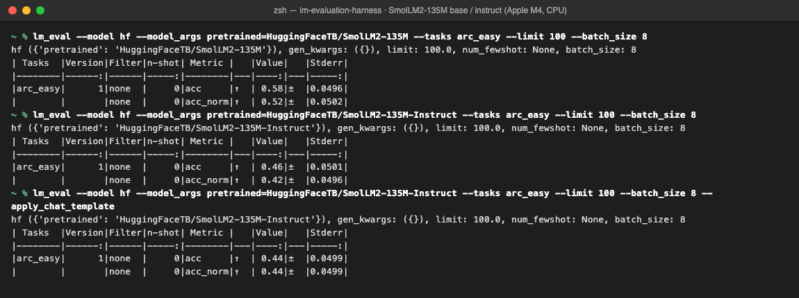

# Task 2 · huggingface/alignment-handbook

Repo: <https://github.com/huggingface/alignment-handbook> · incelenen tarif: [`recipes/zephyr-7b-beta`](https://github.com/huggingface/alignment-handbook/tree/main/recipes/zephyr-7b-beta) · model kartı: [HuggingFaceH4/zephyr-7b-beta](https://huggingface.co/HuggingFaceH4/zephyr-7b-beta)

## 1. Hangi benchmark'lar kullanılmış ve neden?

Zephyr-7B-β iki tür ölçümle raporlanıyor (model kartı, *Performance* ve *Open LLM Leaderboard Evaluation Results* bölümleri):

| amaç | benchmark | Zephyr-7B-β |
|---|---|---|
| Sohbet ve talimat izleme kalitesi (açık uçlu cevapları güçlü bir hakem model puanlıyor) | MT-Bench | 7.34 |
| | AlpacaEval (kazanma oranı) | %90.60 |
| Genel bilgi ve akıl yürütme kaybolmuş mu? | ARC (25-shot) · HellaSwag (10-shot) · MMLU (5-shot) · TruthfulQA (0-shot) · Winogrande (5-shot) · GSM8K (5-shot) | 62.0 · 84.4 · 61.1 · 57.5 · 77.7 · 12.7 |

Neden: Tarifin hedefi sohbet kalitesi (SFT + DPO), bu yüzden ana ölçüt MT-Bench ve AlpacaEval. Leaderboard görevleri ise ince ayarın modelin genel yeteneğini bozmadığını kontrol etmek için. Model kartı da modelin kodlama ve matematikte kapalı modellerin gerisinde kaldığını yazıyor (GSM8K 12.7 bunu gösteriyor).

## 2. Base ile fine-tune modelin farkı nasıl ölçülüyor?

Tarif iki adımlı: önce Mistral-7B, UltraChat'in filtrelenmiş hâliyle SFT ile eğitiliyor (`HuggingFaceH4/ultrachat_200k`), sonra UltraFeedback'in ikili hâliyle DPO uygulanıyor (`HuggingFaceH4/ultrafeedback_binarized`). Her adımın ayarları `recipes/zephyr-7b-beta/sft/` ve `dpo/` altındaki YAML dosyalarında.

Farkı doğru ölçmek için base ve ince ayarlı model **aynı görev, aynı shot sayısı ve aynı araç sürümüyle** koşulmalı. Sohbet modelleri ayrıca kendi sohbet şablonuyla kullanılıyor (model kartındaki örnek `tokenizer.apply_chat_template` çağırıyor). Değerlendirmede şablonun açık mı kapalı mı olduğu sonucu değiştirebiliyor, aşağıdaki deneme bunu gösteriyor.

Not: Tarifin README'sinde, UltraFeedback'teki hatalı etiketler düzeltildikten sonra DPO için 1 epoch ve beta=0.01'in yettiği yazıyor. Model kartında ise 3 epoch yazıyor. Yani aynı modelin raporlanan eğitim ayarı bile kaynağa göre değişebiliyor.

## 3. Küçük deneme: base ve instruct

Repoda SmolLM2 için de bir tarif var (`recipes/smollm2`). Bu yüzden aynı ailenin en küçük modelini, base ve instruct sürümleriyle `lm-evaluation-harness` üzerinden koştum.

```bash
lm_eval --model hf --model_args pretrained=HuggingFaceTB/SmolLM2-135M          --tasks arc_easy --limit 100 --batch_size 8
lm_eval --model hf --model_args pretrained=HuggingFaceTB/SmolLM2-135M-Instruct --tasks arc_easy --limit 100 --batch_size 8
lm_eval --model hf --model_args pretrained=HuggingFaceTB/SmolLM2-135M-Instruct --tasks arc_easy --limit 100 --batch_size 8 --apply_chat_template
```

| model | acc | acc_norm |
|---|---|---|
| SmolLM2-135M (base) | **0.58** | **0.52** |
| SmolLM2-135M-Instruct | 0.46 | 0.42 |
| SmolLM2-135M-Instruct + sohbet şablonu | 0.44 | 0.44 |

*arc_easy, 0-shot, ilk 100 soru, Apple M4 CPU. Standart hata her satırda yaklaşık ±0.05.*



**Yorum:** Bu testte base sürüm instruct'tan 12 puan iyi. Sohbet için yapılan ince ayar, log-olasılıkla puanlanan bu çoktan seçmeli testte puanı düşürdü. Sohbet şablonunu açmak 2 puan daha düşürdü, ama bu fark 100 soruluk örneklemde gürültü sınırında. 12 puanlık fark da yaklaşık 2 standart hata, yani daha büyük bir örneklemle doğrulanmalı. Asıl ders: "instruct daha iyidir" diye varsaymak yanlış. Sonuç, ölçüm biçimine bağlı.

## 4. Kendi benchmark'ıma ne aldım?

1. **Koşulu sabitle ve kaydet.** Her cevapla birlikte istem sürümü, sıcaklık, erişim yolu ve tarih saklanıyor (`sonuclar_*.csv`'de `not`, `erisim`, `tarih` sütunları).
2. **İki tür ölçümü ayır.** MT-Bench gibi hakem model ölçümü ile kodla doğrulanabilen ölçüm ayrı raporlanmalı. Benchmark'ımda kritik bilgiler kodla, anlam kayması iki hakem modelle puanlanıyor; ikisi farklı hataları yakalıyor.
3. **Instruct sürümünü kullan.** Özet gibi üretim görevlerinde base model özet yazmak yerine paragrafı devam ettirebiliyor. Bu yüzden yerelde hep instruct sürümleri koştum (Task 6).
