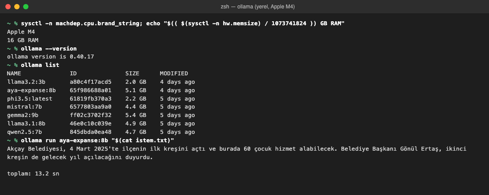

# Task 6 · Yerel model (Ollama)

7 açık ağırlıklı model bu Mac'te **Ollama** ile yerelde koşuldu: Apple M4, 16 GB RAM, ekran kartı yok. Hepsi benchmark'ın 150 sorusunun tamamına cevap verdi (görev 30 soru istiyordu). Aynı sorular bulutta Claude ile de koşuldu.

## Yerel ve bulut karşılaştırması

| model | nerede | doğruluk (150) | uydurmalı özet | sn / soru | maliyet | model boyutu |
|---|---|---|---|---|---|---|
| Claude Opus 5.5 | bulut | **100%** | 0% | – | abonelik | – |
| Claude Sonnet 5.5 | bulut | **100%** | 0% | – | abonelik | – |
| Claude Haiku 5.5 | bulut | **98%** | 0% | – | abonelik | – |
| Aya Expanse 8B | yerel | **77%** | 1% | 15.0 | 0 TL | 5.1 GB |
| Mistral 7B | yerel | **71%** | 3% | 14.3 | 0 TL | 4.4 GB |
| Llama 3.2 3B | yerel | **59%** | 0% | 3.6 | 0 TL | 2.0 GB |
| Qwen 2.5 7B | yerel | **53%** | 1% | 7.2 | 0 TL | 4.7 GB |
| Phi-3.5 3.8B | yerel | **39%** | 45% | 11.7 | 0 TL | 2.2 GB |
| Gemma 2 9B | yerel | **34%** | 2% | 10.9 | 0 TL | 5.4 GB |
| Llama 3.1 8B | yerel | **6%** | 27% | 6.0 | 0 TL | 4.9 GB |

*Yerel modeller: Ollama 0.40, sıcaklık 0, tohum 42, istem v1. Claude modellerinde süre ölçülmedi. Doğruluk: özet üç kritik bilgiyi de koruyor ve hiçbir şey uydurmuyor. Ayrıntılar: [benchmark sonuçları](../benchmark/README.md#sonuçlar).*

## Yerel model ne zaman yeter?

- **Yeter:** Aya Expanse 8B ve Mistral 7B özetlerin dörtte üçüne yakınında üç bilgiyi de koruyor ve neredeyse hiç uydurmuyor. Sonucu bir insanın kontrol edeceği işlerde ücretsiz, internetsiz ve verinin dışarı çıkmadığı bir seçenek.
- **Yetmez:** Açık modellerin asıl hatası bilgiyi atlamak. Phi-3.5 ve Llama 3.1 ise metinde olmayan sayı ve isim uyduruyor. Doğruluğun kritik olduğu yerde (resmî metin, haber) kontrolsüz kullanılamaz.
- **Ne kaybediyorsun:** En iyi yerel model ile Claude arasında 23 puan fark var. Hız sorun değil (soru başına 4–15 sn); asıl kayıp doğruluk ve Türkçe akıcılık. Model seçimi boyuttan önemli: 3B'lik Llama 3.2, 8B'lik Llama 3.1'den 53 puan iyi.
